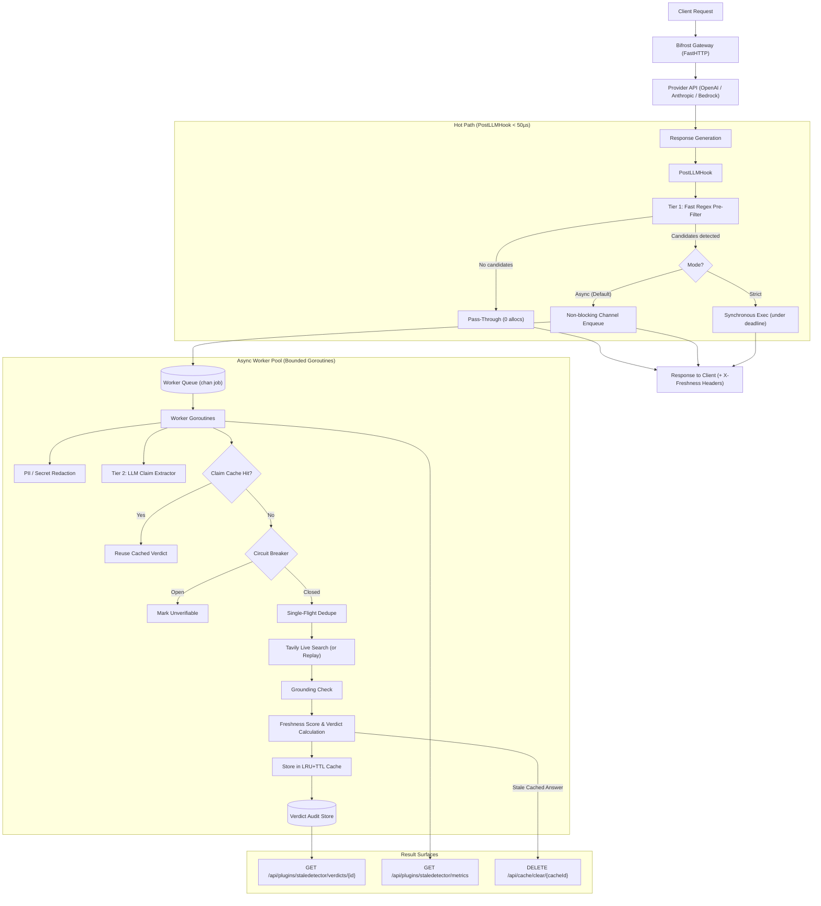

# Stale-Answer Detector: Architecture & System Design

## 1. Overview

**Stale-Answer Detector** is a high-performance, upstream-quality Bifrost gateway plugin and pure-Go verification engine. It detects factual claims in LLM responses that are susceptible to information drift (pricing, API versions, regulations, corporate facts), verifies them against live web sources via Tavily, and attaches an audit verdict, freshness confidence score, and grounded corrections.

---

## 2. Hot-Path Discipline & Zero-Regression Invariant

Bifrost adds ~11µs of overhead at 5,000 RPS. Any plugin on the request path must maintain this discipline:

1. **Sub-Microsecond Rejection:** `HasCandidates()` scans response choices using pre-compiled regexes. Responses without numbers, versions, currencies, or regulation names return immediately with zero heap allocations.
2. **Non-Blocking Hot-Path Enqueue:** In `mode="async"`, `PostLLMHook` never performs network calls, mutex waits, or unbounded memory operations. It drops work if the worker channel is saturated (`select { case queue <- job: default: droppedCount++ }`) and returns the original response pointer immediately.
3. **Never Store Stream Buffers in Context:** Only small strings and handles (`requestID`, `model`) are referenced. All claim caches and verdict buffers reside in the manager instance, never in `BifrostContext`.

---

## 3. Tiered Detection & Extraction Pipeline

### Tier 1: Deterministic Pre-Filtering (`detect.go`)
- Fast pattern matching for:
  - **Pricing:** `$5.00/M`, `costs $20/mo`, `€15 per user`, `cents per token`.
  - **API Versions:** `v2.4.0`, `version 3.12`, `release 14`, `Python 3.11`, `deprecated in v4`.
  - **Regulations:** `EU AI Act`, `GDPR`, `CCPA`, `HIPAA`, `DMA`, `DSA`, `Executive Order 14110`.
  - **Company:** `CEO of`, `acquired by`, `founded in 2015`, `headquartered in San Francisco`.
- Bounded scanning: automatically truncates at `limits.max_response_chars` (default 8,000).

### Tier 2: Structured Claim Extraction (`extract.go`)
- Prompt injection protection: wraps answer in `<untrusted_answer>` delimiters with explicit instructions to ignore prompt instructions.
- Strict schema enforcement: outputs `category`, `entity`, `attribute`, `value`, and `span: [start, end]`.
- **Span Containment Invariant:** The extractor validates that every returned claim exists within the source text span. Hallucinated spans are immediately discarded.

---

## 4. Freshness Scoring Formula

The score $S \in [0, 1]$ represents confidence in claim currency:

### 1. Volatility Risk $v \in [0.10, 0.95]$
Evaluates information drift based on category half-life ($H$) and the gap between model knowledge cutoff and the check date ($\Delta t$):
$$v = 1.0 - \exp\left(-\frac{\Delta t \cdot \ln 2}{H}\right)$$
- **Pricing:** $H = 90$ days (quarterly price changes)
- **API Version:** $H = 120$ days (frequent software releases)
- **Company:** $H = 180$ days (executive and structural moves)
- **Regulation:** $H = 365$ days (legislative timelines)

### 2. Source Authority $a \in [0.20, 0.98]$
- Baseline: $0.70$
- Domain in `domain_allowlist`: $+0.20$
- Evidence published within 30 days: $+0.08$
- Evidence published >365 days ago: $-0.10$

### 3. Verdict & Score Mapping
| Evidence Agreement | Verdict | Formula | Score Range |
| :--- | :--- | :--- | :--- |
| **Match** | `current` | $S = 0.70 + 0.30 \cdot a$ | $[0.76, 1.00]$ |
| **Mismatch** | `stale` | $S = 0.25 \cdot (1 - a)$ | $[0.00, 0.20]$ |
| **None** | `unverifiable` | $S = \min(0.50, 1.0 - v)$ | $[0.05, 0.50]$ |

---

## 5. Result Surfaces (F6)

1. **Verdict Lookup API:** Intercepted at `GET /api/plugins/staledetector/verdicts/{requestId}` via `HTTPTransportPreHook` short-circuit. Serves complete audit JSON records.
2. **HTTP Response Headers:** Attached via `HTTPTransportResponseHeadersHook`:
   - `X-Freshness-Status: checked`
   - `X-Freshness-Verdict-URL: /api/plugins/staledetector/verdicts/{requestId}`
   - `X-Freshness-Score: 0.12`
   - `X-Freshness-Flagged: true` (if any claim has score < `flag_below`)
3. **Strict Mode In-Band Warning:** Appends markdown freshness warning to completion choice content when claims fall below the confidence threshold.
4. **Prometheus Metrics:** Scraped at `GET /api/plugins/staledetector/metrics` with low-cardinality labels.
5. **Semantic Cache Invalidation:** When a stale claim is discovered in an answer served from vector cache (`CacheHit=true`), issues an eviction request to `DELETE /api/cache/clear/{cacheId}`.

---

## 6. Resilience & Security Boundaries

- **Fail-Open Discipline:** Every hook method includes `defer func() { _ = recover() }()`. Plugin errors, network timeouts, or panics never alter or delay the user's response.
- **Circuit Breaker:** Trips after 5 consecutive Tavily failures, transitions to half-open probing after 60 seconds.
- **Hourly Budget Cap:** Limits Tavily credit expenditure (default 200 credits/hour) via atomic sliding-window tracking.
- **PII & Token Redaction:** Automatically scrubs email addresses, phone numbers, and bearer/API secret tokens before dispatching queries or snippets.
- **Grounding Defense:** Any proposed `corrected_value` must be physically present in retrieved web snippets. Ungrounded corrections are downgraded to `unverifiable`.

